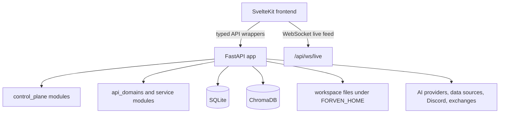

# Arquitectura de Forven

## Descripción General

Forven es un framework de operaciones de trading local-first con tres capas principales:

1. Un frontend SvelteKit para flujos de trabajo del operador
2. Un backend FastAPI para APIs, orquestación y rutas de compatibilidad
3. Persistencia local y estado del espacio de trabajo centrado en SQLite y `FORVEN_HOME`

## Frontend

El frontend vive en `frontend/`.

Stack actual del frontend:

- SvelteKit 2
- Svelte 5
- Tailwind CSS
- Vite
- Vitest y Playwright para cobertura de tests

Convenciones importantes del frontend:

- El acceso a la API pertenece a `frontend/src/lib/api/`
- El estado compartido pertenece a `frontend/src/lib/stores/`
- Los componentes reutilizables viven en `frontend/src/lib/components/`
- Las estructuras de rutas viven en `frontend/src/routes/`

### Superficie de rutas actual

El árbol de rutas activo incluye:

- `/`
- `/agents`
- `/ai-dropzone`
- `/approval`
- `/data`
- `/lab`
- `/lab/strategy/[id]`
- `/memory`
- `/ops`
- `/risk`
- `/runs`
- `/settings`
- `/tasks`
- `/trades`

El panel también soporta `/?view=quant_factory` y `/?view=beta`.

### Conexión frontend-backend

- El servidor de desarrollo Vite proxyza `/api` y `/health` al backend
- La resolución de API del frontend también soporta acceso directo al backend en el puerto `8003`
- Las actualizaciones en vivo usan los endpoints WebSocket expuestos por el backend

## Backend

La app FastAPI está ensamblada en `forven/api.py`.

Responsabilidades clave de la app:

- Registrar routers
- Aplicar CORS
- Aplicar `ForvenV1CompatMiddleware`
- Ejecutar inicialización de inicio a través de `forven.api_core._on_startup`
- Exponer los endpoints de health y rutas websocket usadas por el frontend

### Superficie de routers

El conjunto de routers registrados actualmente incluye:

- `status`
- `notifications`
- `memory`
- `approvals`
- `ops`
- `analytics`
- `data`
- `tasks`
- `trading`
- `paper`
- `jobs`
- `legacy`
- `system`
- `auth`
- `agents`
- `strategies`
- `websockets`
- `quant_factory`
- `webhooks`
- `backtesting`
- `lifecycle`
- `simulation`
- `verdict`
- `robustness`

### Organización del backend

El repositorio usa varias capas en lugar de un monolito único:

- `forven/routers/`: definiciones de rutas HTTP y websocket
- `forven/control_plane/`: comportamiento de runtime orientado al operador como estado, operaciones, aprobaciones y notificaciones
- `forven/api_domains/`: lógica de dominio API y helpers de compatibilidad extraídos
- `forven/strategies/`: clases base de estrategias, registro, optimización y helpers de backtesting
- `forven/api_core.py`: comportamiento compartido de compatibilidad, inicio y legado que aún no se ha extraído completamente

### Capa de compatibilidad

`ForvenV1CompatMiddleware` y las rutas heredadas mantienen funcionando a los clientes antiguos de `/api/forven/*` mientras el frontend actual y las APIs más nuevas usan el diseño de rutas más reciente.

## Persistencia y Estado Local

### SQLite

SQLite es el sistema de registro principal para:

- estrategias y eventos del ciclo de vida
- resultados de backtest y artefactos relacionados
- tareas y registros de auditoría
- aprobaciones
- notificaciones
- estado del scheduler
- trades y posiciones
- configuraciones y estado KV del runtime

La implementación principal vive en `forven/db.py`.

### Estado del espacio de trabajo y autenticación

El estado del runtime por defecto es `~/.forven` a menos que se establezca `FORVEN_HOME`. Los archivos y directorios importantes incluyen:

- `forven.db`
- `auth.json`
- `config.json`
- `workspace/`

### Capa de memoria

ChromaDB se usa para flujos de trabajo de memoria y recuperación. El frontend expone esto a través de la ruta `/memory` y el router de memoria del backend.

## Modelo de Inicio

### Lanzador Windows

`start_all.ps1` es la ruta de arranque más completa en Windows.:

- crea o repara `.venv`
- instala dependencias del backend si faltan
- instala dependencias del frontend si faltan
- inicializa la base de datos
- inicia servicios del backend, frontend y bot/daemon opcionales

### Lanzador Unix

`start_all.sh` inicia servicios del backend, frontend y bot/daemon opcionales después de que las dependencias ya estén instaladas. También carga `.env` automáticamente cuando está presente.

## Endpoints de Salud y Tiempo Real

- Salud del backend: `/api/health`
- Salud de compatibilidad: `/health`
- Estado del sistema: `/api/system/status`
- Informe de soak: `/api/system/soak-report`
- Websocket en vivo: `/api/ws/live` y `/ws/live`

## Reglas de Desarrollo

- Usa importaciones absolutas de Python
- Mantén los routers del backend delgados
- Agrega wrappers de API del frontend en lugar de fetches crudos en componentes
- Trata `forven/exchange/` como código de integración sensible
- Actualiza la documentación cuando cambien las superficies de rutas, los flujos de inicio o el comportamiento del operador
